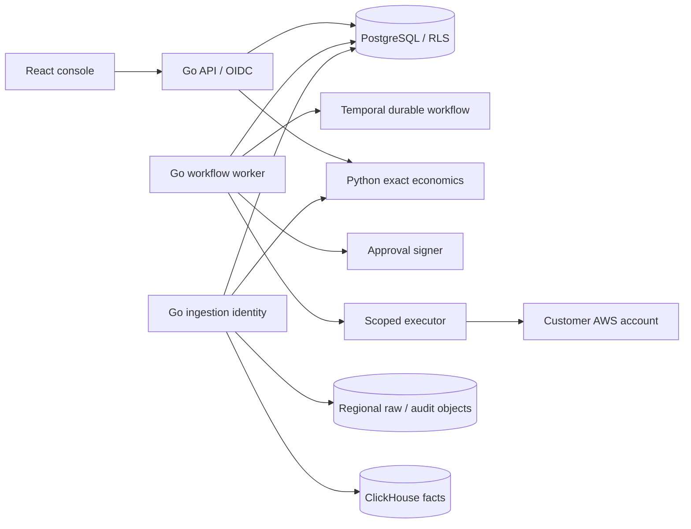

# Cloud Cost Autopilot

An AWS-first FinOps control-plane pilot: discover workloads, measure evidence, approve a non-production EC2 schedule, execute and restore safely, and verify savings against billing.

The first operational slice is approved standalone EC2 stop/start scheduling. Commercial GA remains the larger product contract: AWS, Azure, Google Cloud, Kubernetes, IaC execution and verified workload economics.

## Run the local pilot

Prerequisites: Docker Desktop with Linux containers and Node.js 22+. Go, Python and Terraform builds run in containers.

```powershell
node scripts/bootstrap.mjs
docker compose build minio
docker compose build buckets
docker compose up --build -d
node scripts/smoke.mjs
node scripts/recovery-smoke.mjs
```

Open **http://localhost:3000**. Local fixture login: **owner / local-pilot-demo**. The `viewer` account is read-only; `other` demonstrates a separate tenant. These accounts exist only in the local development realm. Service secrets and signing keys are independently generated in ignored `.env`; the private signing key goes only to the signer process.

Local MinIO and its administration client build from pinned upstream commits in `Dockerfile.local-object-store`; historical community container images are not required. Their first builds take longer. Build them sequentially as shown to limit memory use. Existing named volumes and the upstream images' root UID remain compatible; these object-store containers are confined to the private development network. Hosted deployments use encrypted AWS S3.

The console guides the fixture through recommendation → immutable plan review → approval → execution → restoration → billing verification. Fixture time advances inside the workflow so a complete overnight cycle takes seconds. Every fixture view is labelled; it never invokes live AWS APIs.

The **Cost allocation** view lets Finance/FinOps roles select a persisted source,
save versioned fixed shares and inspect sealed, paginated observed-cost reports.
Signed credits, unknown amounts and currencies remain distinct. Reports capture
current ownership and stay provisional; see [allocation boundaries](docs/cost-allocation.md).

**Connections & quality → AWS commitment portfolio** lets Finance/FinOps users
select issued native receipts and inspect persisted existing-commitment terms,
observed utilization, unused commitment and expiry. Missing evidence remains
unavailable; recommendations and purchases remain gated. See the
[commitment observation scope and optional installation](docs/commitment-portfolio.md).

```powershell
# Stop containers without deleting evidence.
docker compose down

# Containerized Go checks.
docker run --rm -v "${PWD}:/src" -w /src golang:1.27.3-bookworm@sha256:32fa283222e2905d9fee971f60c842e5c815fdc036cf7ea599bf36bd7ca8f67f go test ./...

# Decimal, commitment, billing and savings tests.
docker run --rm -v "${PWD}/economics:/app" -w /app python:3.13-slim python -m unittest discover -s tests -v

# UI contract and build.
cd frontend
npm ci
npm run generate
npm run build
npm run test:e2e
```

The smoke and browser acceptance suites use the owner fixture tenant and must run sequentially. The browser suite requires `npx playwright install chromium` once. Do not use fixture reset commands against live mode; they are rejected there.

The [dependency-safety guide](docs/dependency-safety.md) covers the implemented typed graph, operator declarations, expiring review and signed schema-3 new-stop binding. Run `node scripts/dependency-smoke.mjs` for the 15-check fixture API journey. Contract checks use `go test ./internal/dependency ./internal/store ./internal/service ./internal/workflow`; PostgreSQL cases require a disposable `TEST_DATABASE_URL`, and full source-to-claim integration uses the real Python worker. A unit-only pass does not establish the complete graph/review operating loop.

The bounded [trusted SLO increment](docs/slo-safety.md) adds versioned objectives, dedicated machine minute receipts, signed evaluations and append-only breach disqualification for schema-3 stops. Its rebuilt local stack passed all 15 SLO checks and 20 Chromium tests. Run `node scripts/slo-smoke.mjs` after the activity/dependency smokes; it registers visible owner-tenant SLO history without resetting or executing the owner operating loop. The retained schema-2 fixture path remains available. Local results do not establish live SLO performance or customer acceptance.

## What is in the pilot

- OIDC/PKCE console and tenant-scoped API, forced PostgreSQL row-level security, scoped roles and versioned mutations.
- Separate ingestion service, approval signer, executor and Temporal worker; signed, immutable resource-scoped stop/restoration plans.
- Non-production schedule gates, pause/skip/start-now controls, persisted stop ownership and recovery across process restarts.
- Exact decimal economics, explicit commitment exclusions, workload evidence and invoice-finality gates, and append-only savings/audit history.
- CUR 2.0 normalization with explicit FOCUS 1.4 mapping gaps, raw evidence in versioned object storage and canonical facts in ClickHouse.
- AWS pilot Terraform/Helm assets, CI and operating instructions. Provisioning assets is separate from a verified live customer deployment.

Dependency safety is a bounded capability: current workload `RUNS_ON` mappings plus operator-declared relationships, with review expiry and graph/inventory changes blocking new schema-3 stops. It does not establish automatic complete dependency discovery. An inbound external consumer blocks the pilot's stop, without an inferred SLO exception; existing owned restoration retains authority. The bounded trusted SLO flow passed local fixture acceptance; broad telemetry adapters, full topology/EBS graph integration and production fleet canary behavior remain outstanding. The [acceptance record](docs/acceptance.md) and [progress ledger](docs/progress-ledger.md) distinguish deterministic capability from the remaining live and product-wide gates.



The separate [native Flux lab](examples/flux/README.md) exercises pinned local
controllers, Git-owned rollout, PDB preflight, failed readiness and Git revert.
Its matching successful runtime artifact is required for acceptance. It does
not enable customer execution or financial claims.

The [fleet-history API and optional reader](docs/fleet-history.md) preserve
native ASG points and independently received completed-work evidence. The
console exposes immutable source bindings, missing intervals and unknown
incarnations. Every history scope remains blocked for historical interval
ownership; request throughput remains an explicitly labelled proxy. This does
not enable a fleet action or savings claim.

## Live AWS pilot

Live infrastructure is opt-in and is **not deployed by local startup**. Read [sandbox readiness](docs/sandbox-readiness.md), [evidence contracts](docs/readiness-evidence.md), [dependency safety](docs/dependency-safety.md), [deployment](docs/deployment.md), [operations](docs/operations.md), and [acceptance](docs/acceptance.md) before using live mode. A configured customer identity is bound to exactly one `AWS_TENANT_ID`; the pilot never shares that identity with another tenant. Fresh customer installations create a read role only. API-uploaded financial evidence stays provisional; live execution requires trusted provider and workload evidence integration alongside ownership, configuration authority, fresh safety inputs and uncovered economics. No commissioning bypass is provided.

Optional operator webhooks use `WEBHOOK_URL` and the independently generated `WEBHOOK_SECRET`, supplied only to the worker. An empty URL retains events in the transactional outbox. Live delivery requires HTTPS; receiver configuration and signature verification are described in [deployment](docs/deployment.md).

The fixture passes financial finality using synthetic invoices. A live customer must wait for real observation windows, issued invoices and reconciliation. SOC 2/ISO certification, commercial GA breadth and the specification's platform-wide scale/SLO targets are not established by a local test.

The preserved [product specification](docs/product-specification.md), [233-section delivery map](docs/traceability.md), and [decisions/errata](docs/decisions.md) record the continuing product contract.
