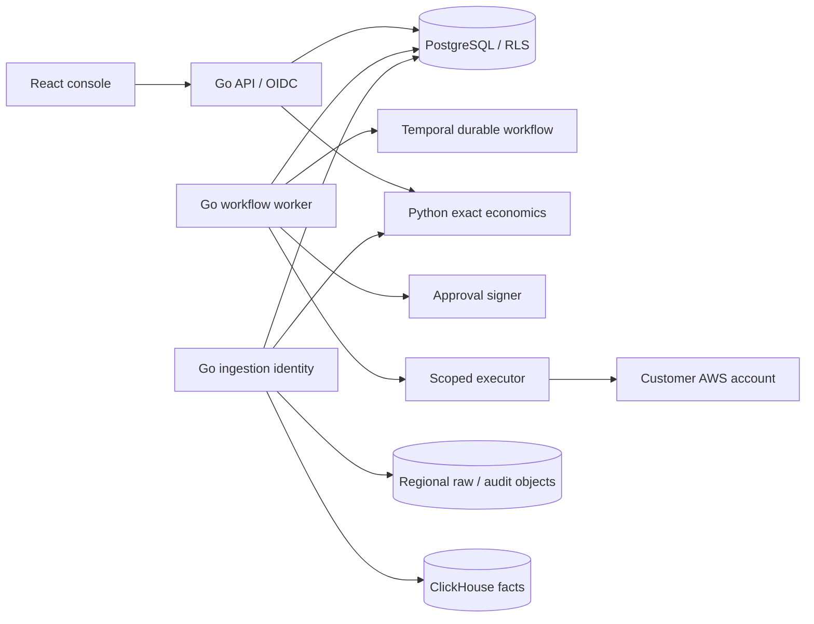

# Cloud Cost Autopilot

An AWS-first FinOps control-plane pilot: discover workloads, measure evidence, approve a non-production EC2 schedule, execute and restore safely, and verify savings against billing.

The first operational slice is approved standalone EC2 stop/start scheduling. Commercial GA remains the larger product contract: AWS, Azure, Google Cloud, Kubernetes, IaC execution and verified workload economics.

## Run the local pilot

Prerequisites: Docker Desktop with Linux containers and Node.js 22+. Go, Python and Terraform builds run in containers.

```powershell
node scripts/bootstrap.mjs
docker compose up --build -d
node scripts/smoke.mjs
node scripts/recovery-smoke.mjs
```

Open **http://localhost:3000**. Local fixture login: **owner / local-pilot-demo**. The `viewer` account is read-only; `other` demonstrates a separate tenant. These accounts exist only in the local development realm. Service secrets and signing keys are independently generated in ignored `.env`; the private signing key goes only to the signer process.

The console guides the fixture through recommendation → immutable plan review → approval → execution → restoration → billing verification. Fixture time advances inside the workflow so a complete overnight cycle takes seconds. Every fixture view is labelled; it never invokes live AWS APIs.

```powershell
# Stop containers without deleting evidence.
docker compose down

# Containerized Go checks.
docker run --rm -v "${PWD}:/src" -w /src golang:1.27.2-bookworm go test ./...

# Decimal, commitment, billing and savings tests.
docker run --rm -v "${PWD}/economics:/app" -w /app python:3.13-slim python -m unittest discover -s tests -v

# UI contract and build.
cd frontend
npm ci
npm run generate
npm run build
npm run test:e2e
```

The smoke and browser acceptance suites use the owner fixture tenant and must run sequentially. The browser suite requires `npx playwright install chromium` once. Do not use fixture reset commands against live mode; they are rejected there.

## What is in the pilot

- OIDC/PKCE console and tenant-scoped API, forced PostgreSQL row-level security, scoped roles and versioned mutations.
- Separate ingestion service, approval signer, executor and Temporal worker; signed, immutable resource-scoped stop/restoration plans.
- Non-production schedule gates, pause/skip/start-now controls, persisted stop ownership and recovery across process restarts.
- Exact decimal economics, explicit commitment exclusions, workload evidence and invoice-finality gates, and append-only savings/audit history.
- CUR 2.0 normalization with explicit FOCUS 1.4 mapping gaps, raw evidence in versioned object storage and canonical facts in ClickHouse.
- AWS pilot Terraform/Helm assets, CI and operating instructions. Provisioning assets is separate from a verified live customer deployment.



## Live AWS pilot

Live infrastructure is opt-in and is **not deployed by local startup**. Read [deployment](docs/deployment.md), [operations](docs/operations.md), and [acceptance](docs/acceptance.md) before using live mode. A configured customer-role pair is bound to exactly one `AWS_TENANT_ID`; the pilot never shares that identity with another tenant. Live execution remains blocked until ownership, configuration authority, workload telemetry, billing and uncovered economics are established.

Optional operator webhooks use `WEBHOOK_URL` and the independently generated `WEBHOOK_SECRET`, supplied only to the worker. An empty URL retains events in the transactional outbox. Live delivery requires HTTPS; receiver configuration and signature verification are described in [deployment](docs/deployment.md).

The fixture passes financial finality using synthetic invoices. A live customer must wait for real observation windows, issued invoices and reconciliation. SOC 2/ISO certification, commercial GA breadth and the specification's platform-wide scale/SLO targets are not established by a local test.

The preserved [product specification](docs/product-specification.md), [233-section delivery map](docs/traceability.md), and [decisions/errata](docs/decisions.md) record the continuing product contract.
